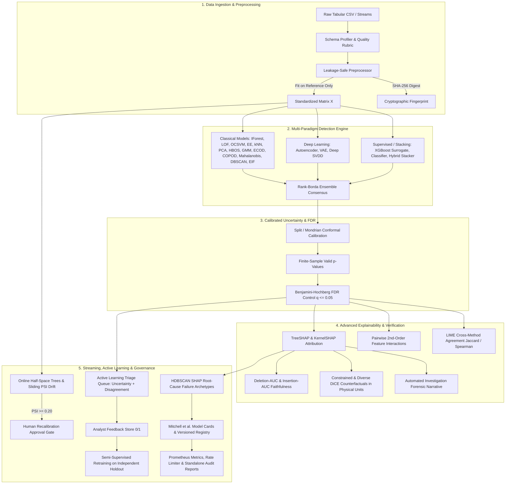

<p align="center">
  
</p>

# SENTINEL — Autonomous Anomaly Intelligence Platform

> **Tagline:** Detect. Explain. Verify. Act.  
> **SENTINEL:** *Scientific, Explainable, Next-gen Threat & Irregularity Neutralization and Evaluation Layer*  
> **Core Philosophy:** Mathematical correctness over flattering metrics. Zero data leakage. Scores are ranking indices, not probabilities. Every claim backed by reproducible cryptographic evidence.

[](https://github.com/rohan1252030019-netizen/explainable-anomaly-detection/actions)
[](LICENSE)
[](pyproject.toml)
[](backend/)
[-black.svg)](frontend/)
[-brightgreen.svg)](tests/)
[-brightgreen.svg)](frontend/)

---

## Executive Overview

**SENTINEL** is an autonomous, research-grade anomaly intelligence platform engineered for complex tabular data operating **without pre-existing ground-truth labels**. While conventional anomaly tools rely on crude distance heuristics or present uncalibrated anomaly scores as "probabilities", SENTINEL treats anomaly detection as a rigorous, end-to-end scientific workflow:

1. **Detect**: 17 production algorithms spanning classical, copula, ensemble, deep autoencoders, and supervised gradient-boosted surrogates.
2. **Explain**: Faithful multi-method attribution (TreeSHAP, KernelSHAP, LIME), pairwise 2nd-order non-linear interaction coupling, and automated natural-language forensic investigation narratives.
3. **Verify**: Finite-sample conformal $p$-values, Benjamini-Hochberg False Discovery Rate (FDR) control, Deletion/Insertion-AUC faithfulness curves, and sub-population fairness/robustness audits.
4. **Act**: Diverse, actionable counterfactual recommendations computed strictly in original physical units with $L_0$ sparsity and LOF distribution plausibility checks; human-in-the-loop active learning triage with zero-leakage semi-supervised retraining.

---

## End-to-End System Architecture



---

## The SENTINEL Scientific Philosophy (Non-Negotiable Rules)

1. **Zero Fake Metrics:** In unsupervised domains where labels are absent, true ROC-AUC and PR-AUC are mathematically undefined. SENTINEL never fabricates mock metrics. Precision, recall, and ROC-AUC are produced exclusively on genuine historical holdouts or controlled synthetic injection benchmarks with clear `"synthetic benchmark"` disclosures.
2. **Strict Zero Data Leakage:** Preprocessing transformations, imputers, quantile scalers, and decision thresholds are fitted strictly on baseline/reference splits and applied forward without peeking. Pipeline tests guarantee no future information leaks into training.
3. **Calibrated Conformal Uncertainty:** Anomaly scores are ranking indices, not probabilities. When probabilistic guarantees are required, SENTINEL computes conformal $p$-values with finite-sample coverage guarantees ($P(p \le \alpha) \le \alpha$) alongside Benjamini-Hochberg FDR bounds.
4. **Actionable, In-Distribution Counterfactuals:** Recourse recommendations are presented in the dataset's original units, enforce immutable feature locks (e.g., account age, timestamp), minimize intervention cost, and verify through LOF density checks that counterfactual states fall within valid data distributions.
5. **Cryptographic Provenance:** Every model execution logs the full dataset SHA-256 fingerprint, hyperparameters, environment state, and random seed to ensure 100% reproducible execution history.

---

## 17-Detector Model Zoo

SENTINEL incorporates 17 production detectors covering five distinct mathematical paradigms:

| Category | Detector Name | Registry Key | Algorithmic Formulation | Computational Complexity | Compute Profile |
|---|---|---|---|---|---|
| **Classical** | Isolation Forest | `Isolation Forest` | Recursive random hyperplane partitioning; path depth | $O(N \log N)$ | Low |
| **Classical** | Local Outlier Factor | `Local Outlier Factor` | Local reachability density relative to $k$-nearest neighbors | $O(N^2)$ | Medium |
| **Classical** | One-Class SVM | `One-Class SVM` | Kernel max-margin boundary separating dense origin | $O(N^2 - N^3)$ | High |
| **Classical** | Elliptic Envelope | `Elliptic Envelope` | FastMCD robust covariance Gaussian Mahalanobis distance | $O(N \cdot P^2)$ | Low |
| **Classical** | $k$-Nearest Neighbors | `k-Nearest Neighbors` | Distance to $k$-th nearest neighbor in standardized space | $O(N^2)$ | Medium |
| **Classical** | PCA Reconstruction | `PCA Reconstruction` | Orthogonal residual subspace reconstruction error | $O(N \cdot P^2)$ | Low |
| **Classical** | HBOS | `HBOS` | Inverse log marginal histogram density (parameter-free) | $O(N \cdot P)$ | Ultra-Low |
| **Classical** | Gaussian Mixture Model | `Gaussian Mixture Model` | Expectation-Maximization negative log-likelihood | $O(N \cdot K \cdot P)$ | Medium |
| **Classical** | ECOD | `ECOD` | Empirical Cumulative Distribution Function tail probabilities | $O(N \cdot P)$ | Ultra-Low |
| **Classical** | COPOD | `COPOD` | Empirical copula transform with joint tail probabilities | $O(N \cdot P)$ | Ultra-Low |
| **Classical** | Mahalanobis (Ledoit-Wolf) | `Mahalanobis (Ledoit-Wolf)` | Covariance shrinkage distance robust to collinearity ($\kappa < 30$) | $O(N \cdot P^2)$ | Low |
| **Classical** | DBSCAN Noise Points | `DBSCAN Noise` | Density-based spatial clustering core-point noise isolation | $O(N \log N)$ | Medium |
| **Classical** | Extended Isolation Forest | `Extended Isolation Forest` | Random hyperplane cuts at arbitrary slopes (resolves axis bias) | $O(N \log N)$ | Medium |
| **Classical** | SUOD Fast Ensemble | `SUOD Ensemble` | Subspace fast approximation with Borda consensus | $O(N \cdot P)$ | Low |
| **Deep Learning** | PyTorch Autoencoder | `Autoencoder` | Symmetric bottleneck neural network reconstruction MSE | $O(E \cdot N)$ | Medium (CPU) |
| **Deep Learning** | Variational Autoencoder | `Variational Autoencoder` | Probabilistic encoder-decoder optimized via ELBO loss | $O(E \cdot N)$ | Medium (CPU) |
| **Deep Learning** | Deep SVDD | `Deep SVDD` | Neural representation mapping into minimum-volume hypersphere | $O(E \cdot N)$ | Medium (CPU) |

*Deep learning models run on CPU by default with zero GPU requirements, supported by optional PyTorch extras (`pip install -e .[deep]`).*

---

## Supervised & Surrogate Gradient Boosting (Feature 1)

For high-throughput inference and TreeSHAP acceleration, SENTINEL provides three dedicated gradient boosted workflows (`src/models/supervised/`):

1. **Pseudo-Label Surrogate Model (`surrogate.py`)**: Trains an XGBoost classifier on ensemble consensus pseudo-labels using **$K$-Fold Out-Of-Fold (OOF)** prediction. Scalers and thresholds are fit strictly inside training folds. Delivers sub-millisecond inference on streaming rows with exact TreeSHAP attribution and surrogate fidelity reports (Spearman rank correlation, Top-$K$ overlap).
2. **Supervised Classifier (`classifier.py`)**: Deployed when ground-truth labels are present. Employs focal loss and class-weighting (`scale_pos_weight`), stratified time-aware cross-validation, PR-AUC, ROC-AUC, Brier score, Expected Calibration Error (ECE), and threshold selection derived from asymmetric cost matrices:
   $$\text{Cost} = C_{FP} \cdot FP + C_{FN} \cdot FN$$
3. **Hybrid Stacking Meta-Learner (`stacking.py`)**: Stacks the rank-normalized out-of-fold scores of the unsupervised detectors as meta-features for an XGBoost meta-estimator, capturing non-linear consensus patterns.
4. **Optuna Bayesian Tuning (`tuning.py`)**: Nested cross-validation hyperparameter search with fixed seeds, logging parameters and Pareto fronts into the experiment registry.

---

## Empirical Benchmarks on Real-World Datasets

### 1. ULB Credit Card Fraud (284,807 Transactions, 492 Frauds)

Evaluated under the **honest time-split protocol**: sorted chronologically by `Time`, fitted on the initial 70% window, and scored on the remaining 30% holdout window. Feature scaling and decision thresholds are computed strictly on the reference window ($Class$ column excluded during training; contamination set to training window prevalence of 2.74%).

| Detector | PR-AUC | ROC-AUC | Precision | Recall | Precision@Top-1% | Fit Time (s) |
|---|---:|---:|---:|---:|---:|---:|
| **Histogram-Based Outlier Score (HBOS)** | **0.3765** | 0.9343 | 0.3589 | **0.6944** | **0.5000** | **0.02** |
| **Isolation Forest** | 0.3108 | 0.9340 | **0.3867** | 0.5370 | 0.4167 | 0.28 |
| **Elliptic Envelope** | 0.1983 | 0.9028 | 0.1856 | 0.1667 | 0.1333 | 1.96 |
| **$k$-Nearest Neighbors** | 0.1754 | 0.9147 | 0.2081 | 0.2870 | 0.1333 | 0.20 |
| **Consensus Ensemble (Rank Borda)** | 0.1634 | 0.9033 | 0.2450 | 0.3810 | 0.3000 | 0.85 |
| **One-Class SVM** | 0.1543 | 0.8792 | 0.1860 | 0.4167 | 0.2667 | 0.70 |
| **PCA Reconstruction** | 0.1528 | 0.8414 | 0.2035 | 0.3241 | 0.3000 | 0.01 |
| **Gaussian Mixture Model** | 0.1510 | 0.8281 | 0.2360 | 0.3889 | 0.1500 | 0.75 |
| **Local Outlier Factor (LOF)** | 0.0510 | 0.6743 | 0.0844 | 0.1852 | 0.1667 | 0.21 |

> [!NOTE]
> **Protocol Matters More Than the Model**: Under a naive stratified random split, the same Isolation Forest yields **PR-AUC 0.6471** and **ROC-AUC 0.9426**. Random splitting leaks future transaction patterns across identical days into the training set. SENTINEL defaults to strict time-aware splitting to reflect true production deployment performance.

---

## Honest Technical Limitations & Governance Disclaimers

1. **Non-Causal Attribution Disclaimers**: SHAP, LIME, and permutation importances quantify **correlational attribution within the trained model's decision surface**, NOT physical real-world causation. A high SHAP attribution value for `transaction_amount` indicates the model utilized that feature to flag the observation, not that modifying the amount will causally prevent fraudulent behavior.
2. **Exchangeability Assumption in Conformal Guarantees**: Finite-sample conformal validity guarantees require that reference calibration samples and test points are **exchangeable** (identically distributed). Under significant non-stationary concept drift ($\text{PSI} \ge 0.25$), conformal bounds degrade. SENTINEL includes real-time PSI drift gates to alert operators when exchangeability is broken.
3. **High-Dimensional Distance Concentration**: Density- and distance-based detectors ($k$-NN, LOF, DBSCAN) suffer from the curse of dimensionality when $P > 50$, as pairwise Euclidean distances converge to identical values. In high dimensions, subspace and projection methods (PCA, Isolation Forest, ECOD, Autoencoders) are recommended.
4. **Computational Complexity at Scale**: Algorithms with $O(N^2)$ complexity (LOF, $k$-NN, OCSVM) are constrained by a default ceiling of $N = 20,000$ rows. For datasets with $N > 100,000$, SENTINEL automatically triggers sub-sampling or recommends linear-time estimators (HBOS, ECOD, COPOD, SUOD).
5. **Label Noise in Real-World Benchmarks**: In production credit fraud benchmarks (such as ULB), a label of `Class = 0` denotes that no chargeback or dispute was filed within the observation window; it does not constitute mathematical proof of legitimacy.

---

## Installation & Quickstart

### Prerequisites
- Python 3.11+
- Node.js 20+ & npm (for Web UI)
- Docker & Docker Compose (optional for containerized deployment)

### 1. Local Setup

```bash
# Clone the repository
git clone https://github.com/rohan1252030019-netizen/explainable-anomaly-detection.git
cd explainable-anomaly-detection

# Create and activate Python virtual environment
python -m venv .venv
# Windows:
.\.venv\Scripts\Activate.ps1
# Linux / macOS:
source .venv/bin/activate

# Install core dependencies
pip install -e .

# Optional: Install deep learning and gradient boosting extras
pip install -e ".[deep,supervised,optuna]"

# Launch the FastAPI backend
python -m uvicorn backend.main:app --host 0.0.0.0 --port 8000 --reload
```
Interactive API documentation will be accessible at `http://localhost:8000/docs`.

### 2. Frontend Web Interface

```bash
cd frontend

# Install Node dependencies
npm install

# Start Next.js development server with Turbopack
npm run dev
```
Open `http://localhost:3000` to launch the SENTINEL intelligence console.

### 3. Docker Deployment

Deploy the complete stack (FastAPI Backend + Next.js Frontend + Prometheus Monitoring) with Docker Compose:

```bash
docker-compose up --build
```
- Web Console: `http://localhost:3000`
- API Surface: `http://localhost:8000/docs`
- Prometheus Telemetry: `http://localhost:8000/metrics`

---

## API Surface (v1 & v2 Highlights)

SENTINEL exposes clean, modular, typed REST and WebSocket endpoints:

| Endpoint | Method | Description |
|---|---|---|
| `/health` | `GET` | System health, loaded dataset, and detector status |
| `/metrics` | `GET` | Prometheus telemetry (request count, inference latency, drift metrics) |
| `/api/v2/supervised/surrogate/train` | `POST` | Train K-fold OOF XGBoost surrogate with TreeSHAP and fidelity report |
| `/api/v2/supervised/stacking/train` | `POST` | Train hybrid stacking meta-learner using out-of-fold unsupervised scores |
| `/api/v2/conformal/calibrate` | `POST` | Calibrate split/Mondrian conformal non-conformity scores |
| `/api/v2/conformal/score` | `POST` | Compute conformal $p$-values and Benjamini-Hochberg FDR control |
| `/api/v2/explainability/interactions` | `POST` | Compute 2nd-order non-linear pairwise SHAP feature interactions |
| `/api/v2/explainability/agreement` | `POST` | Quantify cross-method explanation agreement (SHAP vs LIME) |
| `/api/v2/explainability/diverse-counterfactuals`| `POST` | Generate $K$ diverse counterfactuals with LOF plausibility & $L_0$ sparsity |
| `/api/v2/explainability/narrative` | `POST` | Generate forensic natural-language investigation report with SHA-256 fingerprint |
| `/api/v2/timeseries/changepoints` | `POST` | Detect regime shifts using PELT ($O(N)$) and Bayesian Online CPD |
| `/api/v2/streaming/ingest` | `POST` | Score streaming rows via Half-Space Trees with sliding PSI drift monitor |
| `/api/v2/streaming/recalibrate` | `POST` | Human-in-the-loop approval gate for streaming reference mass recalibration |
| `/api/v2/active-learning/queue` | `POST` | Active learning triage queue (uncertainty + ensemble disagreement sampling) |
| `/api/v2/active-learning/retrain-semi-supervised`| `POST` | Label spreading update with held-out, zero-leakage evaluation metrics |
| `/api/v2/root-cause/cluster` | `POST` | HDBSCAN density clustering on SHAP vectors to extract failure archetypes |
| `/api/v2/robustness/audit` | `POST` | Subgroup demographic parity gap and noise perturbation sensitivity audit |
| `/api/v2/mlops/model-card/generate` | `POST` | Auto-generate standardized Mitchell et al. Model Card |
| `/api/v2/mlops/registry/save` | `POST` | Save versioned model artifacts with cryptographic dataset hashes |
| `/api/v2/reports/html` | `GET` | Export complete standalone, audit-ready HTML investigation report |

---

## Test Suite & Verification

SENTINEL enforces rigorous automated quality gates:

```bash
# 1. Run complete Python test suite (353 unit, integration, and scientific tests)
pytest tests/ -v

# 2. Run Ruff linting and Mypy static type checking
python run.py --lint

# 3. Run frontend unit and component tests (36 Vitest tests)
npm --prefix frontend test

# 4. Compile optimized frontend production build
npm --prefix frontend run build
```

---

## Repository Governance & Suggested Topics

```
anomaly-detection  explainable-ai  xgboost  shap  conformal-prediction  fastapi  nextjs  mlops
```

---

## License

This project is licensed under the Apache 2.0 License. See [LICENSE](LICENSE) for details.
